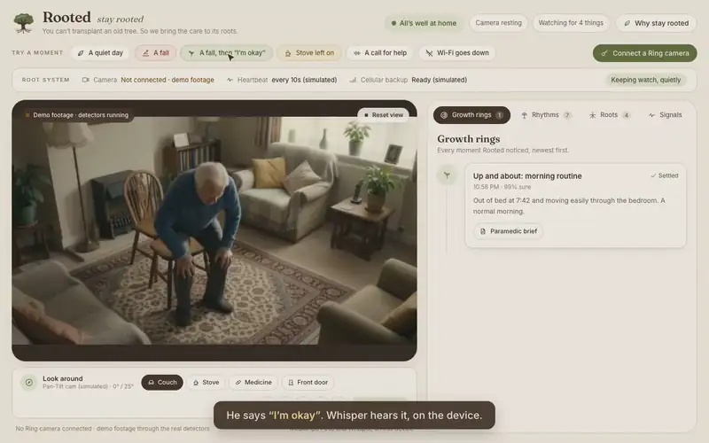
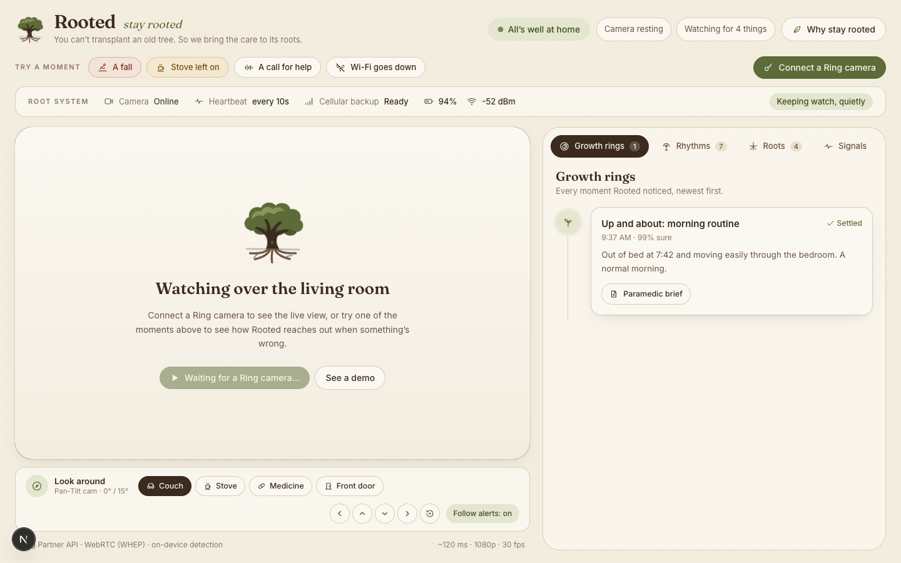
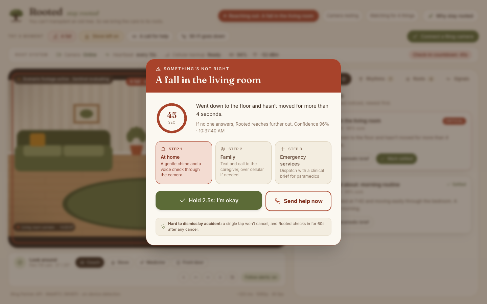
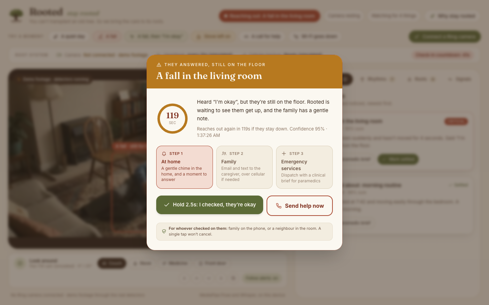
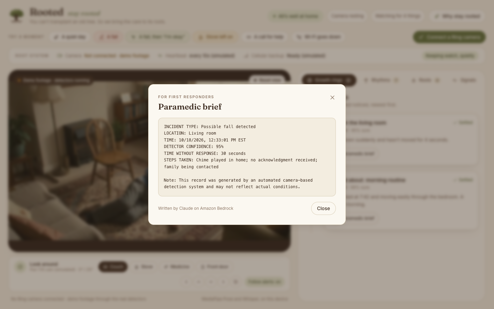
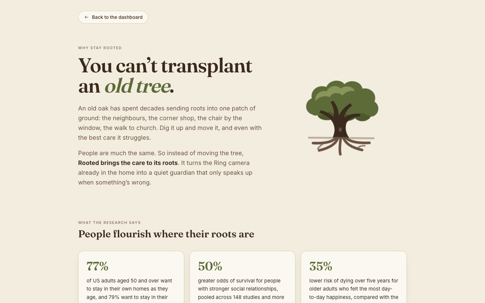
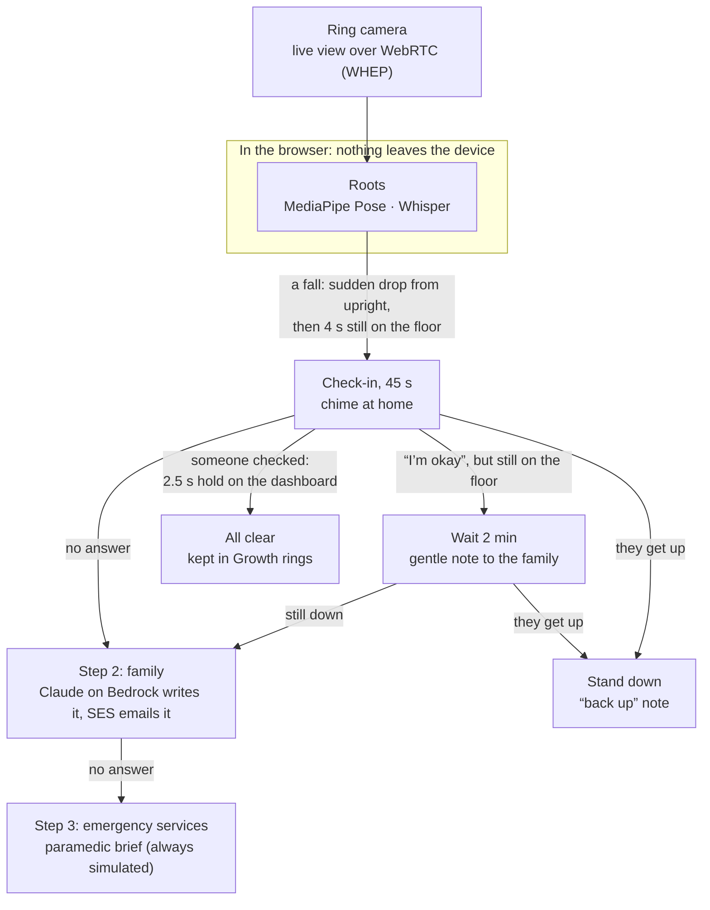

# Rooted

> **You can’t transplant an old tree. So we bring the care to its roots.**
> Rooted turns the Ring camera already in the home into a quiet guardian, so older adults can keep living where their roots are.
> Built for the **Build, Ship, Shape: Amazon Developer Hackathon 2026** (Ring track: Caretaking & Accessibility).




> **For judges, in one minute**
> - **Try it live:** [rooted-eight-ecru.vercel.app](https://rooted-eight-ecru.vercel.app). Press **A fall**, then **A fall, then “I’m okay”**. The detectors run in your browser on demo footage; the public version sends no emails.
> - **Watch it:** the demo video (under 3 minutes) is on the Devpost submission.
> - **What’s real:** pose fall detection, the “I’m okay” and call-for-help listener (Whisper), the check-in and escalation, the Bedrock-written brief and the SES email, and the Ring Partner API discovery and live view, tested on the Ring Playground. Simulated: the stove, sensors, chime and 911. [The full table](#whats-real-and-whats-simulated).
> - **Private by design:** video and audio never leave the device. [How](#dignity-and-privacy).
> - **Where it runs:** on an always-on device in the home (an old laptop, a tablet, a small PC) with the dashboard open. The family doesn’t need it open: alerts reach them by email, and by text once SMS is set up. [Limits](#where-it-runs-and-its-limits).

---

## Why stay rooted

An old oak has spent decades sending roots into one patch of ground. Move it, and even with the best care it struggles. People are much the same. Their neighbours, their routines and their own front door are part of what keeps them well.

| Finding | Source |
| :--- | :--- |
| **77%** of US adults 50+ want to stay in their homes as they age; 79% want to stay in their communities. | [AARP Home and Community Preferences Survey, 2021](https://www.aarp.org/research/topics/community/info-2021/2021-home-community-preferences.html) |
| **50%** greater odds of survival with stronger social relationships (148 studies, 300,000+ people). | [Holt-Lunstad, Smith & Layton, *PLoS Medicine*, 2010](https://doi.org/10.1371/journal.pmed.1000316) |
| **35%** lower 5-year mortality for older adults with the most day-to-day happiness vs. the least, after adjustment. | [Steptoe & Wardle, *PNAS*, 2011](https://pubmed.ncbi.nlm.nih.gov/22042845/) |
| **11–15%** longer lifespan for the most optimistic people, and better odds of living past 85. | [Lee et al., *PNAS*, 2019](https://doi.org/10.1073/pnas.1900712116) |
| Living alone was tied to higher mortality only where people felt little connection to their neighbours. | [Jiang et al., Rutgers (PINE study)](https://www.rutgers.edu/news/strong-connection-neighbors-may-improve-health-outcomes) |
| Relocating older people without preparation carries a higher risk of poor outcomes. | [Holder & Jolley, *Reviews in Clinical Gerontology*, 2012](https://kar.kent.ac.uk/32428/) |

These are observational studies. They show strong, consistent associations, not proof of cause. The app’s **Why stay rooted** page (`/why`) tells the same story for families.

What usually forces the move is fear of the fall nobody sees. [About 1 in 4 adults over 65 falls each year](https://www.cdc.gov/falls/data-research/index.html), and the panic pendant stays on the nightstand.

---

## What Rooted watches for: the four roots

1. **A fall.** [MediaPipe Pose](https://ai.google.dev/edge/mediapipe/solutions/vision/pose_landmarker) runs in the browser on every frame of the Ring stream. A fall is the hips dropping a third of the person’s own standing height within 1.5 s from upright, then the torso flat and hips at floor level for 4 seconds of stillness. Measuring against their own height means it works near or far from the camera. Lying down slowly counts as resting, and only raises a gentler alert after a minute still on the floor, not on a sofa or bed. Bent knees under an upright back count as sitting, because a high corner camera makes a seated person’s legs look long.
   The “upright first” rule came from the Ring Playground: its sample stream is a bird feeder, and the pose model briefly read a woodpecker as a person on the floor. No alert fired, but now a drop only counts if the torso was upright just before it. A non-human shape can still read as “lying down”, which would only alert after a minute without movement.
   *Tested on the [UR Fall Detection Dataset](http://fenix.ur.edu.pl/~mkepski/ds/uf.html) (front camera, color only): 5–6 of 8 fall runs detected depending on the run, 0 alerts across 9 everyday clips (sitting, bending, lying down on purpose). That was measured on Oct 13 2026, before the “upright first” and bent-knee sitting rules. Falls straight toward the camera are missed, because the body looks upright when foreshortened. On 6 generated wide-angle living-room clips: 3 of 3 falls (tripping on a rug, collapsing beside a chair, sliding down a wall) and 0 of 3 everyday moments (sitting on a sofa, lying down on it to read, picking something up), re-run on Oct 18 2026 with the current rules. A small sample, not a clinical validation. The “Try a moment” fall plays one of those generated clips through the same detector, so the alert you see is a real detection. A scripted alert stands in only if the pose model can’t load, for example offline.*
2. **A stove left on.** A burner on in the kitchen while nobody is there. Scripted in the demo today; vision on the stove zone is in progress.
3. **A call for help.** [Whisper](https://huggingface.co/onnx-community/whisper-tiny) runs on the device in a Web Worker (transformers.js) on the camera’s audio track, listening for “Help!”, “I fell” or “I can’t get up”. No audio leaves the browser. Each 3-second window takes a few seconds to transcribe on a laptop CPU, so the alert follows the call by several seconds. English is tested; set `NEXT_PUBLIC_LISTEN_LANGUAGE=es` for a Spanish-speaking home (untested).
4. **A quiet camera.** A missed heartbeat (Wi-Fi or power down) moves alerts onto a cellular backup. Simulated today: neither is in the Ring API.

## How it reaches out: three steps

When something is wrong, a 45-second check-in starts, and the person can answer it (see below). If nobody answers, Rooted reaches further out:

1. **At home.** A chime in the home. The Ring API has no talk-back, so there is no spoken check; Ring Chime playback is the closest option (simulated in the demo).
2. **Family.** An email to the caregiver, written by Claude on Amazon Bedrock (tested). A text message is built but hasn’t reached a test phone yet.
3. **Emergency services.** Dispatch with a paramedic brief. Always simulated here.

Every moment is kept in **Growth rings**, the family’s timeline.

**Who answers the check-in?** Someone on the floor can’t reach a screen, so they answer the room:

- **Say “I’m okay.”** Whisper is already listening on the camera’s audio, so it hears “I’m okay” (or “I’m fine”, “estoy bien”) on the device. If they’re still on the floor, Rooted doesn’t take their word for it, because people often say they’re fine when they aren’t. It waits two minutes, sends the family a gentle “they fell and say they’re okay” note, and reaches out again if they stay down.
- **Get up.** When the pose detector sees them back on their feet after a fall, the alert stands down by itself and the family gets a short “back up” note.
- **Someone who checked.** The dashboard’s hold button is for whoever checked on them: family on the phone, or a neighbour who looked in.

The **“A fall, then ‘I’m okay’”** moment runs all three on real detection: a fall, “I’m okay” from the floor, then the pose detector seeing him stand.

**Hard to cancel by accident, easy to cancel on purpose.** “I checked, they’re okay” is a 2.5-second hold, so a stray tap can’t dismiss a real fall. “Send help now” gives 15 seconds to undo a mistaken press, and every cancel is followed by a 60-second quiet check.

**Daily rhythms.** Ring Alarm contact and motion sensors and the smoke/CO listener would add context: the medicine cabinet opened, a trip to the fridge, the front door at night. In the demo they’re simulated, and so is the Pan-Tilt Indoor Cam turning toward an alert, because pan-tilt isn’t in the public API.

| A quiet day, detectors live | A fall: the check-in | “I’m okay”, still on the floor |
| :---: | :---: | :---: |
|  |  |  |
| **The paramedic brief** | **Why stay rooted** | |
|  |  | |

---

## How a fall moves through Rooted



The incident record (what was detected, where, when, how sure) is the only thing that leaves the browser, and only at the family step.

---

## Dignity and privacy

A camera watching someone’s parent has to earn its place in the home. What Rooted does today, as built:

- **Video and audio stay on the device.** The Ring live view goes straight to the browser over WebRTC, and MediaPipe Pose and Whisper run there. Rooted records nothing, saves no frames, and keeps nothing in browser storage.
- **Only an incident record goes further.** At the family step, the server gets what was detected, where, when and how sure the detector was. Claude on Bedrock writes the email from that record alone and is told never to add symptoms or anything the camera couldn’t see. Every brief ends by noting that it comes from an automated camera detector.
- **A calm room stays clean.** The detector only draws a box on the person when something needs attention, and on most days nothing does.
- **The person answers for themselves.** Saying “I’m okay” or getting up counts. The family hears from Rooted only after a 45-second check-in goes unanswered, or gets a gentle note if they said “I’m okay” from the floor; emergency services come only after the family step.
- **The family timeline lives in the open page.** There’s no database; Growth rings is gone when the page closes.

Not built yet, and needed before a real home: the person’s own consent and a way to pause watching, privacy zones (Ring supports them per camera), and controls over which family members can open the live view.

---

## Where it runs, and its limits

The detectors run in the dashboard’s browser tab, so in a real home that tab stays open on an always-on device in the house: an old laptop, a tablet or a small PC, plugged in and set never to sleep. Video goes from the camera to that device and no further. The family doesn’t keep anything open. They get the alert by email (and by text once SMS is set up), and can open the dashboard from anywhere to look in or to hold the alert after they’ve checked.

What that means today:

- **If the device sleeps, loses Wi-Fi or closes the tab, Rooted stops watching.** The camera heartbeat that should catch this is simulated in the demo.
- **Ring live views end after 30 s (battery) or 60 s (wired).** The dashboard reconnects in a loop, and whatever happens in a gap can be missed.
- **The chimes play on the device running the dashboard.** A chime through the home’s Ring Chime is simulated.
- **No phone app or push notifications yet.** Email is the tested channel.

Next: a small always-on Rooted hub that runs the same detectors without a browser window, Ring Chime playback, and push notifications to the family.

---

## Quick start

### Prerequisites
- Node.js 18+
- npm or pnpm

### 1. Install
```bash
git clone https://github.com/tanDivina/rooted.git
cd rooted
npm install
```

### 2. Add a Ring token (optional)
The **Try a moment** buttons work without one. To stream a camera, generate a token in the [Ring Playground](https://developer.amazon.com/ring/console/playground) (it lasts 30 minutes) and either paste it into **Connect a Ring camera** in the dashboard, or put it in `.env.local`:

```bash
cp .env.example .env.local
```

```env
RING_ACCESS_TOKEN=eyJhbGciOiJSUzI1NiIsInR5cCI6IkpXVCJ9...
```

A token pasted in the dashboard stays in the server’s memory for that run and is never written to disk.

### 3. Run
```bash
npm run dev
```

Then open [http://localhost:3000](http://localhost:3000).

---

## Demo guide

The dashboard’s **Try a moment** buttons play generated clips through the real detectors, so it works without a camera:

| Button | What happens |
| :--- | :--- |
| **A quiet day** | He reads the paper. The detectors run (open **Roots** to see pose read “sitting” and the listener on) and nothing needs anyone, which is most days. |
| **A fall** | He collapses getting up from a chair; after 4 s of stillness the pose detector raises the alert and the check-in starts. Watch it climb from step 1 to step 3. |
| **A fall, then “I’m okay”** | The same fall, but he says “I’m okay” from the floor. Rooted waits instead of escalating, then stands down when he gets up with the chair. |
| **Stove left on** | A kitchen alert for a burner left on with nobody there (scripted). |
| **A call for help** | An empty living room while someone out of view calls “Help me, please, I fell and I can’t get up!”; Whisper hears it and raises the alert. |
| **Wi-Fi goes down** | Cuts the camera’s heartbeat, and Rooted switches to the cellular backup (simulated). Click again to restore. |
| **Connect a Ring camera** | Paste a Ring Playground token and press **Start live view**: Rooted finds the device through the Ring API and streams it over WebRTC (WHEP). Tested on the Playground’s sample device. |

---

## What’s real and what’s simulated

I built Rooted without any Ring hardware. On Oct 17 2026 I ran it against the Ring Playground, whose sample device streams a real clip over the Ring API, so discovery and live video are tested. Nothing has run on a physical camera yet.

| Real and tested | Built against the Ring API, not yet tested | Simulated for the demo |
| :--- | :--- | :--- |
| Ring device discovery (`/v1/devices`) and live video over WebRTC (WHEP), with a Playground token on the Playground’s sample device | The detectors on a live Ring stream with a person in view (the sample clip is a bird feeder), and on a physical camera | Stove detection (scripted trigger) |
| MediaPipe Pose fall detector (tested on the UR Fall dataset and generated living-room clips; the “A fall” moment runs it live) | Device status (`/v1/devices/{id}/status`) as the heartbeat: the Playground device reports offline even while it streams | Contact, motion and smoke/CO sensor events |
| Call-for-help listener: Whisper on the device, on the audio track (English tested on a generated clip; the “A call for help” moment runs it live) | | The camera heartbeat, cellular backup, battery and Wi-Fi health (not in the API) |
| Answering the check-in: a spoken “I’m okay” (Whisper) pauses escalation while they’re still down; getting back up (pose) stands it down (tested on a generated clip) | | |
| Check-in countdown and three-step escalation | | |
| Family email (Amazon SES) at step 2 | The OAuth refresh-token flow; the family text (Amazon SNS), which sends but hasn’t reached my test phone yet | In-home Ring Chime |
| Paramedic brief and family message written by Claude on Amazon Bedrock (template fallback offline) | Signed webhooks streamed to the dashboard over SSE | Pan-Tilt motor control (not in the public API) |
| | | The 911 dispatch, always: a hackathon app should never call emergency services on its own |

**Next:** vision on the stove zone, smoke-alarm beep detection on the stream’s audio track, Ring sensors over webhooks, a real Ring Chime sound, and a first run on a physical Ring camera.

All the footage is AI-generated with Gemini Omni Flash: the quiet afternoon (started from a still edited with Nano Banana so the newspaper is already in his hands), the fall, the fall answered with “I’m okay” (continued from the fall clip’s last frame), the call for help and the stove left on. The voices are ElevenLabs. The people and voices are generated, not real.

## Add your own root

Each detector is a small plugin that gets every video frame. To add one, for example a root that notices the lights left off at night:

1. Create `lib/video-processors/care/night-light.ts` implementing `VideoProcessor` from `lib/video-processors/types.ts`. Start its `id` with `care-` and it appears under **Roots** with a toggle and its live values.

   ```ts
   import { VideoProcessor, ProcessorResult } from '../types'

   export class NightLightProcessor implements VideoProcessor {
     id = 'care-night-light'
     name = 'Night light'
     description = 'Notices the room going dark while someone is still up'
     enabled = true
     private onIncident?: (incident: any) => void
     setIncidentCallback(cb: (incident: any) => void) { this.onIncident = cb }

     async process(frame: ImageData): Promise<ProcessorResult | null> {
       let sum = 0
       for (let i = 0; i < frame.data.length; i += 16) sum += frame.data[i]
       const brightness = Math.round(sum / (frame.data.length / 16))
       // ...call this.onIncident({ id, type, severity, timestamp, title, description, confidence, resolved: false, escalationLevel: 1 })
       return { id: `night-${Date.now()}`, processorId: this.id, timestamp: Date.now(), data: { brightness } }
     }
   }
   export const nightLightProcessor = new NightLightProcessor()
   ```
2. Register it in `lib/video-processors/index.ts` with `processorRegistry.register(nightLightProcessor)`.
3. To start the check-in, wire its callback in `app/page.tsx` next to the others (`setIncidentCallback(handleNewIncident)`), and add your incident `type` to `CareIncident` in `lib/types/care.ts`.

The same pipeline runs on a video file, so a new root can be tested on a clip before it ever sees a camera, the way every root here was.

## Built during the hackathon

Rooted started from Amazon’s [Ring API Hello World](https://github.com/AmazonAppDev/ring-api-helloworld) starter (auth, device list, WHEP player, webhook receiver, video-processor framework). Everything else was built for this hackathon: the four care detectors (`lib/video-processors/care/`), the check-in countdown and three-step escalation, the family timeline and paramedic brief, the heartbeat and cellular-fallback model, pan-tilt and sensor fusion, the demo footage, the `/why` research page, and the whole Rooted design (palette, type and a custom icon set).

---

## Hackathon tracks

- **Primary track:** Ring (Caretaking & Accessibility).
- **AWS Builder mini-challenge:** at step 2, Claude on Amazon Bedrock writes the family message and paramedic brief from the incident record, and Amazon SES emails them to the family (the Amazon SNS text is built but hasn’t reached my test phone yet). It runs on Claude Opus 4.5; set `BEDROCK_MODEL` to move to Opus 5.5 once your account has access. A least-privilege IAM user (`scripts/aws/`) is all the server can use.
- **Open source mini-challenge:** MIT licensed; see [LICENSE](LICENSE).

---

## Product feedback: friction log

What worked and what slowed me down on the Ring Developer Platform. I had no Ring hardware and tested against the Ring Playground; items marked *(docs)* come from the API documentation, not a test.

**Worked well**
1. **WHEP streaming.** Standard WebRTC plays in a browser with no RTSP transcoding, so frames go straight into a canvas and the fall detector runs privately in the browser. The starter’s player streamed the Playground device on the first try.
2. **The Playground’s sample device.** A one-click token and a device that streams a sample clip let me test discovery and live video with no hardware at all.
3. **The starter template.** The video-processor interface (`init` / `process` / `cleanup`) made it easy to drop in new detectors, and the same pipeline runs on a file as on a stream, which is how I tested without a camera.

**Friction**
1. **I found the Playground device late.** The getting-started guide lists a Ring device as a requirement, so I built most of Rooted believing there was no way to test streaming without one. A line saying the Playground has a streaming sample device would save new developers that detour.
2. **A second live view on the same token sent no video.** The first session streamed. Later sessions, in Rooted and in the Playground’s own player, came back `201` with no frames. Rooted now times out after 15 s and says so instead of showing a black “live” view; a clear error or a documented limit would help.
3. **Device status says offline while streaming.** `/v1/devices/{id}/status` reports `online: false` for the Playground device even mid-stream, so status can’t serve as the camera heartbeat there.
4. **Live streams stop after 30 or 60 seconds *(docs)*.** Battery cameras stream for 30 s, wired ones for 60 s. A care dashboard has to reconnect in a loop, so the detectors miss whatever happens in the gaps. A longer session for approved care use cases would help.
5. **Audio is receive-only *(docs)*.** The audio track works for hearing a call for help, but there’s no talk-back, so the gentlest step (a voice asking “Are you okay?”) isn’t possible through the camera. Ring Chime playback of a stored sound is the closest option.
6. **No pan-tilt control *(docs)*.** I couldn’t find pan-tilt in the public API, so a care app can’t turn an indoor camera toward the person who needs help.
7. **Short-lived Playground tokens.** Tokens last 30 minutes, and a care dashboard stays open all day. A development token that lasts a day would help.
8. **No care-shaped test footage.** The Playground clip is a bird feeder. Care apps need a living room, a kitchen and a person who sits, stands and falls, so I generated my own.
9. **Long-lived event streams and tooling.** The SSE webhook relay keeps a connection open, so headless test tools that wait for “network idle” never finish. Not a Ring bug; a note in the template docs would help.

---

## License
MIT. Rooted © 2026 Dorien Van den Abbeele; portions from the Ring API Hello World starter © 2026 Amazon. See [LICENSE](LICENSE).
